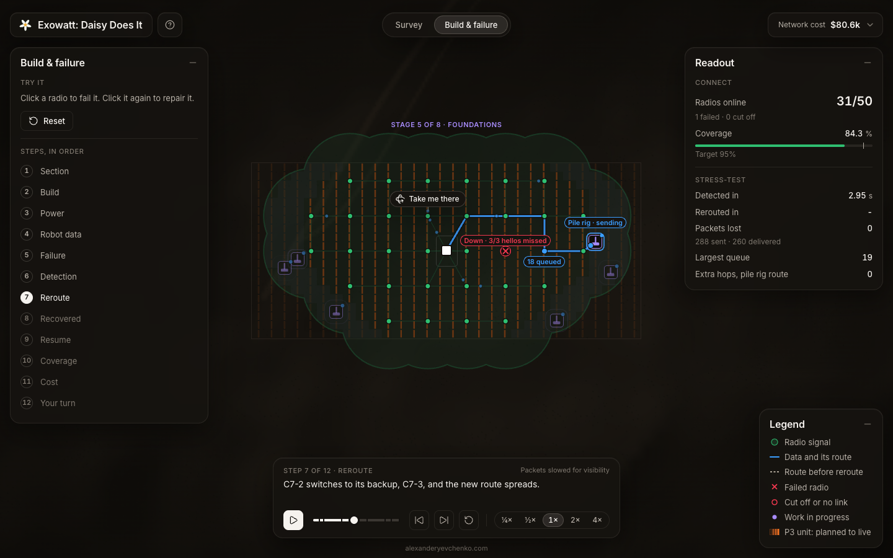

# Exowatt: Daisy Does It

How to keep every machine online while a 2,000-acre, 23,000-unit Exowatt P3 site is surveyed and built.

[](https://mitec.alexanderyevchenko.com)

[](https://mitec.alexanderyevchenko.com)

## What the demo shows

- **Survey:** UTVs, each with lidar front and back and a drone that follows it, survey the full site over Starlink on their own strips around the base pad; pick 1 to 8 UTVs and press Send to see the time change.
- **Build & failure:** a section of the site is built from the center out in stages, with a mesh of radios on the units carrying every machine's data to the base; mid-build a radio fails and a robot's data reroutes around it without losing a packet; then click any radio to fail or repair it.
- **Guided tour:** the app opens on a short home page, and a coach-mark tour walks you through the tabs, the map and its colors, the walkthrough player, hover cards and "Your turn"; replay it any time from the ? button.
- **Cost and alternatives:** a cost chip on each tab opens the breakdown from sourced prices, the survey UTV's kit part by part, and a comparison with the other ways to do the job.

## Run it locally

```sh
cd daisy-demo && npm install && npm run dev
npm test
```

Stack: React 18, TypeScript, Vite, Zustand and canvas 2D, tested with Vitest.

Built for MITEC Hack '26: [alexanderyevchenko.com](https://alexanderyevchenko.com).
